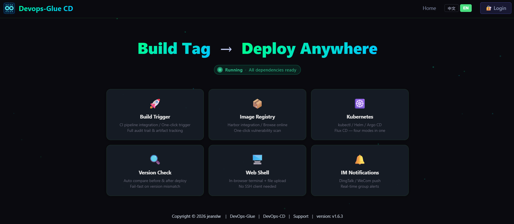
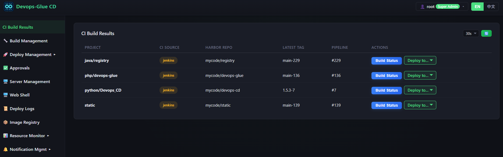

# Devops-Glue CD

A FastAPI-based continuous deployment service that works alongside [Devops-Glue API](https://github.com/jeanslw/Devops-Glue.git) to deploy Docker images to Docker or Kubernetes clusters. 

[](https://github.com/jeanslw/devops_cd/releases/latest)
[](https://github.com/jeanslw/Devops_CD/actions/workflows/ci.yml)
[](https://github.com/jeanslw/Devops_CD/actions/workflows/security.yml)
[](https://github.com/jeanslw/Devops_CD/commits/main/)
[](https://hub.docker.com/r/jeanslw/devops-cd/tags)
[](https://hub.docker.com/r/jeanslw/devops-cd)
[](https://github.com/jeanslw/devops-glue)

✅ DevOps-Glue API: Multiple Git platforms, multiple CI channels, Docker repositories → all handled! 
✅ From CI building to CD deployment, full process coverage

**[Chinese](README_ZH-CN.md)**




## Overview

- **Repository**：https://github.com/jeanslw/devops_cd.git or https://gitee.com/jeanslw/devops_cd.git
- **Language**：Python 3.10+
- **Framework**：FastAPI + uvicorn (async)
- **Frontend**：Vue 3 + Vite + Vue Router 4 + xterm.js 5.3
- **Database**：SQLite / MySQL 8.0+ / MariaDB 10.4+
- **Port**：8081
- **Authentication**: Devops-Glue single sign-on (OIDC), the only login method. Identity and permissions come from the Glue API. 
<details>
## <summary> Quick Start (click to expand)</summary>

```bash
git clone https://github.com/jeanslw/devops_cd.git
cd devops_cd
python -m venv venv

# Linux / macOS
source venv/bin/activate

# Windows
venv\Scripts\activate

pip install -r requirements.txt

# Configure environment (deployment values: database / Harbor / CI credentials / SECRET_KEY)
cp .env.example .env
# DB_DRIVER=sqlite (default; a dedicated .db file works — or share the PHP API's file, e.g. ../php_api/config/data/data.db)
# or DB_DRIVER=mysql (recommended; dedicated CD database, or shared with the PHP API)
# SECRET_KEY: bare-metal may leave it empty (auto-generates .cd_secret_key); docker compose REQUIRES it
# (read-only container cannot write the key file) — openssl rand -base64 32 (see docs/ADMIN_MANUAL.md)
# Application parameters (timeouts / cache TTLs / intervals / monitoring switch) live in config/app.env with sane defaults
# Authentication: Devops-Glue single sign-on (OIDC) => set OIDC_ISSUER / CD_OIDC_SECRET / CD_OIDC_REDIRECT_URI in .env

python main.py
# Open http://localhost:8081
```

### Docker Compose

```bash
cp .env.example .env
# Application parameters come from config/app.env inside the image; to override one, add it to .env and run `docker compose up -d` (no --build needed)
docker compose up -d --build
# Open http://localhost:8081
```
</details>
> **SQLite caveat**：The CD Service can use its own SQLite file; if it shares one with the PHP API, mount the database directory as a shared volume when deploying in containers. For production, MySQL or MariaDB 10.4+ is strongly recommended to avoid SQLite write contention.

## Documentation

- [USER_MANUAL](docs/USER_MANUAL.md)
- [ADMIN_MANUAL](docs/ADMIN_MANUAL.md)
- [FAQ](docs/FAQ.md)
- [CHANGELOG](docs/CHANGELOG.md)
- [ARCHITECTURE](docs/ARCHITECTURE.md)

## Related Projects

- **Devops-Glue** — CI service ([GitHub](https://github.com/jeanslw/Devops-Glue) | [Gitee](https://gitee.com/jeanslw/devops_glue))

## Contact
PR：[GitHub Issues](https://github.com/jeanslw/Devops_CD/issues)
For feature requests or bug reports, open an issue on the GitHub repository, or email: jeanslw@gmail.com